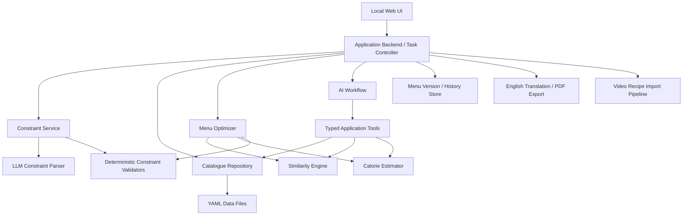

# Architecture and Technical Design

## 1. Design Goals

- Local-first, readable data storage.
- Deterministic validation for correctness-sensitive operations.
- LLM use limited to tasks that benefit from language understanding or generation.
- Shared constraint logic between full-menu generation and local menu adjustment.
- Clear separation of user-owned master data, AI candidates, approved dishes, menus, and task state.
- Expandable constraint types without rewriting the orchestration flow.
- Global menu optimization with independently verifiable hard constraints.
- Explainable optimization results, including infeasibility and trade-offs.

## 2. Proposed High-Level Architecture



This is a logical design, not a commitment to a particular web framework or agent runtime.

## 3. Runtime and Agent Orchestration

### 3.1 Runtime (decided — see ADR-003, ADR-004, ADR-005 in §12)

The core workflow runs in ordinary application code. Claude is called at explicit boundaries:

- **Structured calls (no tools):** constraint parsing, translation. The application sends text and a JSON schema and validates the returned object.
- **Agent calls (application-provided read-only tools):** candidate-dish generation, video recipe extraction. Claude chooses which tools to call; the application still validates every result before use.

Callers depend on a backend-neutral LLM interface, not on a specific invocation method, so the backend can be switched without rewriting callers.

This keeps execution, permissions, validation, and termination conditions under application control.

### 3.2 Agent and Tool Responsibilities

**LLM-assisted tasks**

- Parse natural-language constraints into a typed schema.
- Generate candidate recipes using available ingredients.
- Explain infeasibility and propose possible relaxations for user approval.
- Extract recipes from transcripts and available video context.
- Translate recipe content into English.

**Deterministic tools and services**

- Query ingredients and approved dishes.
- Validate ingredient IDs and dish schemas.
- Estimate calories from recipe quantities and servings.
- Aggregate dish categories and meal composition.
- Calculate dish similarity and whole-meal similarity.
- Check repetition windows.
- Solve the menu optimization problem.
- Save and version menu data.
- Export PDFs.

The LLM must not bypass application permissions or write canonical YAML directly.

## 4. Data Storage

YAML is the source of truth. Layout (implemented in Phase 1):

```text
data/
  ingredients.yaml        user-owned master data; AI read-only
  dishes.yaml             approved dishes only
  pending_dishes.yaml     AI-generated / imported candidates (pending or rejected)
  constraints.yaml        persistent constraints only
  preferences.yaml        default diners and scoped feedback
  menus/
    <menu_id>/
      v001.yaml           one immutable file per menu version
      v002.yaml
```

The authoritative schemas are the pydantic models in `meal_planner/models.py`; every file carries `schema_version: 1` so that future migrations are possible. Cross-file rules (unique IDs, ingredient references, which review status belongs in which file, feedback and menu references) are in `meal_planner/catalogue.py`. All problems found while loading are reported together, each with file, record ID and field, for example `dishes.yaml: dishes[dish_0003].dish_type: Field required`.

Menu versions are never overwritten. The latest version is the current menu; a new version records `based_on_version` and `change_note`. This replaces the earlier proposal of a current-menu file plus a separate history directory (see ADR-009).

### 4.1 Ingredient Records

- `ingredient_id` (`ing_<slug>`), `name_zh`, optional `name_en`, `aliases`, `notes`.
- `category`: fixed enum `vegetable`, `meat`, `poultry`, `seafood`, `egg`, `soy`, `mushroom`, `grain`, `seasoning`, `other` (ADR-010).
- Optional `kcal_per_100g` and `grams_per_unit` (for example `{个: 150}`) (ADR-008).

AI may read this file but may not mutate it. Enforcement is structural (ADR-012): AI workflows receive only `ReadOnlyCatalogue`, which holds an in-memory snapshot, has no reference to the data directory or `DataStore`, and returns immutable records or copies. Only `DataStore.save_ingredients` writes the file, and it is called only for an explicit user edit.

### 4.2 Dish Records

- `dish_id` (`dish_<nnnn>`), `name_zh`, optional `name_en`.
- `dish_type`: `vegetarian`, `mixed`, `meat`, `soup` (ADR-007).
- `ingredients`: lines of `{ingredient_id, quantity, unit, note}`. `quantity` is optional (for example "适量" goes in `note`), but a quantity requires a unit. A line may instead carry `unmatched_name` for an ingredient that is not in the catalogue yet; this is allowed only in pending dishes and must be resolved before approval.
- Optional `servings`, `steps`, `calories_kcal` with `calorie_basis` (`computed` or `estimated`).
- `style`: `main_ingredients` (ingredient IDs), `cooking_method`, `flavours`, free-text `cuisine` (ADR-011).
- `source` (`manual`, `ai_generated`, `video_imported`), optional `source_url`, `review_status`, `uncertainty_notes`, timestamps.

Do not conflate dish role with similarity features. Use stable IDs for references.

### 4.3 Constraint Records

Each constraint should preserve both natural-language intent and executable interpretation.

Illustrative YAML:

```yaml
constraint_id: C001
description: "Every dinner includes exactly one soup"
scope:
  - menu_generation
  - menu_adjustment
strictness: hard
source: persistent
execution:
  type: dish_type_count
  dish_type: soup
  min: 1
  max: 1
parse_status: executable
active: true
```

This is illustrative, not a finalized schema.

Useful metadata includes:
- Stable ID.
- Natural-language description.
- `scope`: `menu_generation`, `menu_adjustment`, or both.
- `source`: `persistent` or `task`.
- `strictness`: `hard` or `soft`.
- `execution`: structured execution type and typed parameters.
- `parse_status`: the parser outcome (see below).
- Conflict and override information.
- `active`: whether the constraint is currently enabled.

Two different status vocabularies apply to a constraint and must not be mixed:

- **`parse_status`** describes whether the constraint itself could be understood and represented: `executable`, `approximated`, `needs_clarification`, `unsupported`, or `conflict` (see `requirements.md` §3.2). It is stored with the constraint.
- **Validation result** describes whether a specific menu satisfies the constraint: `passed`, `failed`, `not_evaluable`, `approximated`, or `conflict` (see §7). It is produced per menu by the validator and stored in the menu's validation report, not in the constraint record.

The schema must support unsupported, approximate, ambiguous, and conflicting constraints. Never discard the original natural-language description after parsing.

### 4.4 Menu Records and History

A menu should record:
- Menu ID and version.
- Plan date range and the 20 target dinner dates.
- Diner composition.
- Selected dish IDs per dinner.
- Effective constraints or a stable snapshot/reference to them.
- Optimization and validation report.
- Unresolved or approximated constraints.
- Creation source and timestamps.
- Change history and rationale.

Prefer versioned writes rather than destructive in-place replacement. Use safe/atomic file writes and backups where practical.

## 5. Constraint Parsing and Resolution

### 5.1 Parsing Pipeline

1. Load persistent constraints.
2. Accept task-scoped additional natural-language constraints.
3. Parse new or changed text into typed constraint candidates.
4. Validate output against a schema and allowed constraint registry.
5. Determine whether each constraint is executable, approximate, ambiguous, unsupported, or conflicting.
6. Resolve explicit task-level overrides; ask the user about implicit conflicts.
7. Produce an effective constraint set for the requested task.
8. Pass validated structured rules to the optimizer and validators.

### 5.2 Constraint Registry

Implemented in `meal_planner/constraint_types.py`. Each executable type is a typed parameter model selected by its `type` field; `Constraint.execution` must match one of them, so a YAML file or parser result with an unknown type or invalid parameters is rejected.

| Type | Parameters | Meaning |
|---|---|---|
| `dish_count` | `min`, `max` | Dishes per dinner, soup included |
| `dish_type_count` | `dish_type`, `min`, `max` | Dishes of one type per dinner |
| `ingredient_exclusion` | `ingredient_ids`, `categories` | Dishes containing these are not used |
| `exact_repeat_window` | `weeks` (1–4) | Same dish not repeated within the window |
| `dish_similarity` | `max_similarity` (optional), `window_weeks` | Discourage similar dishes |
| `meal_similarity` | `max_similarity` (optional), `window_weeks` | Discourage similar whole dinners |

Every type supports both `hard` and `soft` strictness. Calorie constraints are not registered (ADR-008). Validators and optimizer contributions for each type are added in Phases 3–4.

Do not interpret arbitrary LLM-generated code as a constraint implementation. Adding a new executable constraint type requires reviewed application code and tests.

### 5.2.1 Parsing, Task Constraints and the Effective Set (implemented in Phase 2)

- `constraint_parser.parse_constraints` sends the rules, the type descriptions and the ingredient list to the model as one structured call and validates every result itself:
  - A result that is missing, duplicated, malformed, of an unknown type, or `executable` without parameters leaves the constraint `unparsed`, with the reason recorded in `parse_notes`. There is no retry.
  - A reference to an unknown ingredient ID turns the result into `needs_clarification`.
  - `conflict` is never accepted from the model.
- The parser proposes `strictness`. New constraints start as `hard` before parsing, so that nothing is relaxed silently. The user can change strictness afterwards.
- Persistent constraints are added, edited, removed and parsed through `constraints.py`. Changing the description resets the constraint to `unparsed`.
- Task constraints use IDs `T001`, `T002`, … and the scope of exactly one task (generation or adjustment). They are never saved to `constraints.yaml`. A task constraint replaces a persistent one only when it lists that constraint in `overrides`.
- `build_effective_set(persistent, task_constraints, task)` does the following:
  - selects the active persistent constraints for the task;
  - applies explicit overrides;
  - reports blocking issues: `unparsed`, `needs_clarification`, `unknown_override`, and `conflict`.
- Conflicts are detected deterministically:
  - disjoint `dish_count` ranges;
  - disjoint `dish_type_count` ranges for the same type;
  - per-type minimums that add up to more than a total maximum.
  
  Conflicts are reported, never resolved automatically. `unsupported` constraints do not block planning but are listed so that they can be reported.

### 5.3 Constraint Execution Model

The architecture distinguishes the following stages:

1. **Intent:** the user's original natural-language statement.
2. **Interpretation:** structured parameters proposed by the parser.
3. **Capability check:** whether available data and tools can evaluate the rule.
4. **Execution:** a validator or optimizer objective uses the structured rule.
5. **Reporting:** the system reports the result and any limitations.

An LLM's assertion that a constraint is satisfied is not a validation result.

## 6. Menu Optimizer Design

### 6.1 Recommended Approach

Treat menu planning as a global constrained optimization problem.

Evaluate Google OR-Tools CP-SAT as the first solver candidate. Keep the optimizer behind a small interface so a different solver or hybrid method can be substituted after prototyping.

Do not make 20 independent greedy choices: locally good choices can make later dates infeasible.

### 6.2 Inputs

The optimizer receives:

- The 20 target dinner dates.
- Diner composition and calorie target assumptions.
- Approved dish catalogue.
- Effective structured constraint set.
- Dish and ingredient features required for constraint checks and similarity.
- Relevant menu history and configured repetition window.
- Optional fixed menu items, especially for local adjustments.
- Solver configuration and optimization weights.

Pending or rejected dishes must not be selectable.

### 6.3 Decision Variables

For each target date and candidate dish, define a binary selection variable indicating whether that dish is selected for that meal.

The implementation may use explicit meal-role slots or model each meal as a set of selected dishes, depending on how flexible dish-type rules are.

A variable should only be created for a dish that is valid and eligible for the corresponding task. The model should not rely on an LLM to determine whether a completed solution meets the rules.

### 6.4 Hard Constraints

Depending on the effective constraint set, hard constraints may include:

- Required number of dishes and soup count per meal.
- Allowed dish-type counts and composition.
- Ingredient exclusions or required ingredients.
- Exact-repeat restrictions within a configured window.
- Approved-dish-only selection.
- Explicitly non-negotiable user instructions.
- Valid dates and fixed diner composition.

Hard constraints that cannot be expressed directly in the solver model must be checked separately. The plan must not be labelled fully feasible unless all applicable hard constraints pass the final validator.

### 6.5 Soft Objectives

Represent soft objectives as explicit penalties or rewards with configurable and documented weights.

Candidate objectives include:
- Deviation from the daily calorie target.
- Excessive similarity between dishes across dates.
- Excessive whole-meal similarity across dates.
- Repetition beyond the configured strict-repeat window, where permitted.
- Insufficient variety in cooking method, flavour, cuisine, or main ingredient.
- Mismatch with user preferences.

Avoid one opaque weighted score without a report. Return per-objective scores and explain the main trade-offs.

Where priorities are important, consider staged or lexicographic optimization, for example:
1. Find a solution satisfying all hard constraints.
2. Improve calorie consistency.
3. Improve variety and reduce excessive similarity.
4. Optimize lower-priority preferences.

The final ordering and weights remain open design decisions.

### 6.6 Calorie Estimation

Calorie estimation is deterministic given the nutrition facts, ingredient quantities, yields, and serving assumptions, but the underlying data may be approximate or missing.

Record:
- Estimated calories and unit basis.
- Number of servings or yield.
- Data coverage or confidence.
- Missing-nutrition warnings.

Do not imply medical-grade precision. If nutrition data is incomplete, expose uncertainty and use the result as an approximate planning signal.

### 6.7 Dish Similarity

Dish similarity is a deterministic score in the range 0–1 based on available features.

Candidate features include:
- Main ingredients.
- Cooking method.
- Flavour.
- Cuisine/style.
- Core ingredient combination.

Initial feature weights are tunable configuration and must be validated against representative examples. Missing features must be handled explicitly; missing data must not automatically be treated as evidence of dissimilarity.

Exact identity by `dish_id` should be checked separately from approximate similarity.

### 6.8 Whole-Meal Similarity

The initial whole-meal similarity baseline is the user's greedy matching procedure:

1. Build the cross-meal dish similarity matrix.
2. Select the highest-scoring remaining pair.
3. Add its score and remove the matched dishes.
4. Repeat until no pairs remain.
5. Sum matched scores.

Also compute a normalized score when comparing meals with different dish counts.

Preserve this baseline unless a future design decision explicitly changes it.

### 6.8.1 Implementation (Phase 3)

These modules are deterministic and do not call an LLM:

- `calories.py`:
  - **Unit conversion:**
    - Mass units (`g`/`克`, `kg`/`公斤`/`千克`, `斤`, `两`) convert directly.
    - Any other unit, including volume, needs the ingredient's `grams_per_unit`.
  - **Missing data is listed, not guessed.** A line is listed with its reason when it has no quantity, no gram weight for its unit, or no `kcal_per_100g`.
  - **Totals only when complete.** `total_kcal` and `per_serving_kcal` are given only when every line was converted. Otherwise only `known_kcal` and `coverage` are reported.
- `checks.py`:
  - Dish-type counting and range checks for `dish_count` and `dish_type_count`.
  - Exclusion hits, by ingredient ID or by category.
  - Exact repeats in a sliding calendar window of `weeks × 7` days (ADR-016). Earlier menus can be included in the input.
- `similarity.py`:
  - **Dish similarity** is the weighted average of these feature scores:
    - Jaccard of `main_ingredients`;
    - Jaccard of recipe ingredients with seasonings excluded;
    - same `cooking_method`;
    - Jaccard of `flavours`;
    - same `cuisine`.
  - **Missing features.** A feature missing on either dish, or set to `other`, is left out and the remaining weights are renormalized. `coverage` reports the share of total weight that was actually compared. With no comparable feature the score is `None`.
  - **Whole-meal similarity** uses the baseline greedy matching:
    - `total` is the sum of the matched pair scores.
    - `normalized` is `total` divided by the larger meal size (ADR-016).
    - `mean_matched` is also reported.
    - Pairs with an unknown score are never matched; they are counted in `unknown_pairs`.

### 6.9 Hybrid Optimization Strategy

Whole-meal similarity is awkward to encode directly in a compact constraint model. The proposed first implementation is therefore a hybrid:

1. The solver produces a feasible, high-quality initial plan using tractable dish-level penalties.
2. A deterministic evaluator computes whole-meal similarity across the plan.
3. Local search or repair proposes swaps or replacements to reduce the worst similarity violations while preserving hard constraints.
4. An independent final validator checks the complete menu and reports soft-objective scores.

This strategy must be benchmarked with representative catalogue sizes before it is finalized. If a simpler solver model adequately meets quality and runtime requirements, prefer the simpler implementation.

### 6.10 Infeasibility and Catalogue Expansion

If the approved catalogue has no feasible solution:

1. Return a structured explanation of the constraints or candidate categories causing the shortage.
2. Identify the smallest useful catalogue gap where possible.
3. Ask the LLM to generate targeted candidate dishes using known ingredients.
4. Validate the candidate schema and ingredient references.
5. Place candidates in pending review.
6. After user approval, add approved candidates and rerun the optimizer.

Do not silently relax hard constraints or automatically approve generated dishes. If suggesting a relaxation, explain its impact and wait for the user's decision.

### 6.10.1 Implementation (Phase 5)

**Requests.** `candidates.requests_for_gaps` turns each `CatalogueGap` into a request for `max(minimum, ceil(factor × missing dishes))` dishes of the missing type. The defaults are factor 1.5 and minimum 5 (`settings.candidates`).

**Generation.** `candidates.generate_candidates` makes one agent call using the `dish_generation` model and the read-only tools in `ai_tools.py` (`list_ingredients`, `search_ingredients`, `list_dishes`).

- The prompt states the request and the hard ingredient exclusions.
- Every draft is validated in code. A draft is **rejected with a reason, never repaired**, if:
  - it does not match the schema, or a quantity has no unit;
  - its dish type is not the requested one;
  - it uses an unknown ingredient ID;
  - it contains an excluded ingredient;
  - its name duplicates an approved or pending dish.
- An ingredient that is not in the catalogue may appear only as an `unmatched_name` line. It is flagged for the user and never created.
- Valid drafts get new `dish_<nnnn>` IDs, `source: ai_generated` and `review_status: pending`, and are saved to `pending_dishes.yaml` only.

**Review.** `review.apply_review` applies a batch of `approve`, `edit` and `reject` decisions.

- The whole batch is validated first and written only if every decision is valid.
- **Approve:**
  - A dish with `unmatched_name` lines cannot be approved; the user edits the line to a catalogue ingredient first.
  - The dish moves to `dishes.yaml` through `DataStore.save_dishes_and_pending`. That method validates the combined result once, then writes `dishes.yaml` before `pending_dishes.yaml` (ADR-018).
- **Edit:** the dish keeps its `dish_id`, `source`, `source_url` and `created_at`.
- **Reject:** the dish stays in `pending_dishes.yaml` as `rejected` and cannot be approved later.

**Re-planning.** After approval, the planner uses the updated catalogue. A test covers the complete loop: gap → candidates → approval → feasible plan.

### 6.11 Menu Adjustment

Reuse the same constraint registry, validators, similarity engine, and optimizer.

1. Create a proposed new menu version with the target dish removed from its position.
2. Find replacement candidates compatible with the meal role and active constraints.
3. Solve the local replacement problem.
4. Validate the meal and compare its whole-meal similarity against other dates.
5. If no feasible local replacement exists, expand to the day or a larger date range.
6. Preserve unrelated approved dishes whenever possible.
7. Show the proposed diff and validation report before committing the new version.

### 6.12 Implementation (Phase 4)

Modules:

- `plan_context.py`: the inputs of one run (approved dishes only, ingredients, settings, earlier menus, disliked dishes) and a dish-similarity cache.
- `solver.py`: the CP-SAT model.
- `repair.py`: local repair of whole-meal similarity.
- `validator.py`: the independent final validator.
- `planner.py`: the orchestration and the infeasibility explanations.

Flow of `plan_menu`:

1. **Blocked.** The effective constraint set must be ready, and a `dish_count` with a minimum must exist. Otherwise the result is `blocked`, with the reasons.
2. **Capacity check.** This proves catalogue shortfalls without solving. For each hard count minimum it compares servings needed (`20 × min`) with eligible dishes × the maximum uses per dish allowed by the strictest hard repeat window. Eligible means approved and not hard-excluded. A shortfall gives `infeasible` with a `CatalogueGap` that says how many more dishes of which type are needed; this is the input for Phase 5 candidate generation.
3. **CP-SAT.** The model has one boolean per (date, eligible dish).
   - Hard rules become constraints.
   - Soft rules become penalty terms with the weights in `settings.planner` (ADR-017).
   - Dish similarity is modelled per (day pair, dish) with an enforcement literal: when dish *a* is served on day *i*, a penalty variable covers all similar dishes on day *j*.
   - Whole-meal similarity is not modelled.
4. **Proven infeasible.** Each hard constraint is dropped in turn and the model re-solved (10 s each). The constraints whose removal alone allows a plan are reported as relaxation candidates. Nothing is relaxed automatically.
5. **No solution within the time limit.** The result is `no_solution_found`, never `infeasible`.
6. **Repair.** Deterministic first-improvement local search on the dinners in the worst meal-similarity violations. It replaces one dish with another of the same type, and keeps a change only if the validator reports fewer hard violations, or the same number with a lower total penalty. Fixed dishes and dates outside `free_dates` are never changed.
7. **Validation.** The independent validator sets the final status. The solver result is only a candidate.

Planning inputs also support `fixed` (dishes forced on given dates) and `free_dates` (other dates keep only their fixed dishes), for local adjustment in Phase 7.

Benchmark (`benchmarks/bench_planner.py`, synthetic catalogue, typical rules: 4 dishes, 1 soup, ≥1 meat, ≥1 vegetarian, no repeat within 2 weeks, soft dish and meal similarity within 1 week; 8 workers; 2026-10-12):

| Dishes | Threshold 0.5 | Threshold 0.3 | Threshold 0.2 (stress) |
|---|---|---|---|
| 100 | optimal, 2.6 s | optimal, 3.1 s | time limit, penalty 762 after repair |
| 200 | optimal, 4.5 s | optimal, 6.6 s | optimal, 9.7 s |
| 300 | optimal, 5.8 s | optimal, 11.4 s | optimal, 15.5 s |

All runs gave the same menu on repeated runs.

The synthetic catalogue is much less similar than a real one is likely to be: only 0.3% of dish pairs score above 0.5. Thresholds and solve times must be re-checked on the real catalogue.

A pairwise model, with one variable per (similar dish pair × day pair), found better solutions in the 100-dish stress case. However, it found no solution at all for 300 dishes within 30 s, and it was not repeatable. The aggregated model was chosen.

### 6.11.1 Implementation (Phase 7)

`adjust.propose_replacement(ctx, effective, menu, date, dish)` tries four scopes in order and stops at the first one that the validator accepts as `feasible` or `feasible_with_unresolved`.

| Scope | What may change |
|---|---|
| `dish` | Only the target dish is replaced; the rest of its dinner and all other dinners are fixed. |
| `dinner` | The target dinner may be rebuilt. |
| `week` | The target's plan week may change. |
| `menu` | The whole menu may change. |

- **Dates outside the scope** keep exactly their dishes.
- **Inside a wider scope**, existing dishes are preferred: each dropped dish costs `planner.penalty_change` points (default 300), and the repair step may not touch them.
- **The replaced dish** is banned on its date.
- **Diagnosis.** Infeasibility diagnosis (relaxation candidates) runs only at the `menu` scope.
- **Blocked.** A `blocked` result (constraint problems) stops immediately, because widening the scope cannot help.
- **Explanation.** Every attempted scope is reported with its status and reason.

Adjustment uses the persistent constraints scoped to `menu_adjustment` plus its own task constraints (scope `menu_adjustment` only; generation-task constraints are refused). History from other saved menus is included for repeat checks.

`adjust.save_adjusted_version` stores a confirmed proposal:

- The dinners are validated again on the server.
- The result is stored as version `latest + 1`, with `based_on_version`, a required change note, the constraint snapshot and the report.
- Earlier versions are never modified.
- Optional dislike feedback is recorded in `preferences.yaml` with scope `this_menu`, `future_menus` or `persistent`:
  - `this_menu`: the dislike penalty applies only when adjusting that menu.
  - `future_menus` and `persistent`: the penalty applies to every later plan.
  - A dislike never deletes the dish.

The menu page shows each version's changes relative to the version it was based on.

## 7. Deterministic Validation

The final validator is independent of the LLM and returns machine-readable results per constraint, such as:

- `passed`
- `failed`
- `not_evaluable`
- `approximated`
- `conflict`

It checks the final complete menu, not just the intermediate solver result. Any change after validation invalidates the previous report and requires revalidation.

The overall plan status should distinguish:
- Feasible and validated.
- Feasible with unresolved or non-evaluable soft constraints.
- Infeasible under current hard constraints.
- Best-effort proposal that has not passed all required checks.

## 8. Video Import and PDF Export

### Video Import

Separate pipeline:

URL intake → accessible metadata/transcript retrieval → optional ASR/vision → structured recipe extraction → ingredient ID matching → schema validation → pending review.

Platform availability and permitted access must be checked. Do not assume every URL can be downloaded or transcribed.

#### Implementation (Phase 8)

`meal_planner/video_import.py`, endpoint `POST /api/videos/import`, panel on the review page.

1. **URL intake.** The URL is checked against the supported patterns (`youtube.com/watch?v=`, `/shorts/`, `youtu.be/`, `bilibili.com/video/BV…|av…`, `b23.tv/…`). Anything else fails with a clear message.
2. **Text retrieval.** yt-dlp reads the title, the description and one subtitle track. It never downloads the video or audio. Track choice:
   - uploaded subtitles in any language (Chinese, then English, then any other) are preferred;
   - otherwise, automatic captions in the video's language are used;
   - Bilibili danmaku and live chat are ignored.
   
   The VTT, SRT and JSON subtitle formats are converted to plain text.
3. **No subtitles.** The description is used if it has at least 60 characters. Otherwise the import fails ("no subtitles; speech recognition not supported") without calling Claude. Text longer than 20,000 characters is cut, and the cut is noted.
4. **Extraction.** One structured Claude call (`video_extraction` model) receives the video text and the ingredient list. It is told to use only what the text states.
   - The output is validated in code.
   - A video without a recipe (`found_recipe: false`) or malformed output fails, and nothing is saved.
5. **Ingredient matching.** An `ingredient_id` proposed by the model is accepted only if it exists. Otherwise the name is matched exactly (Chinese name, alias or English name, case-insensitive). Unmatched names become `unmatched_name` lines for review. There is no fuzzy matching, and the catalogue is never changed.
6. **Pending review.** The dish is saved to `pending_dishes.yaml` with `source: video_imported` and `source_url`. Its `uncertainty_notes` include the model's doubts and the text source (uploaded subtitles, automatic captions, or description only).

**Verification.** On 2026-10-12, a real YouTube video's title and uploaded subtitles were read through yt-dlp (`MEAL_PLANNER_LIVE_VIDEO_URL` live test). Bilibili access was not verified live; videos that need login or are region-restricted fail with yt-dlp's message.

### English PDF

Use approved recipe/menu data as input. Translation should preserve quantities, sequence, timing, and cooking details.

Validate that the PDF contains the expected recipes and is printable.

#### Implementation (Phase 9)

`meal_planner/translation.py`, `meal_planner/pdf_export.py`. On the menu page, "导出英文 PDF" calls `POST /api/menus/<id>/export/translate` and then downloads `GET /api/menus/<id>/export.pdf?version=`.

**Translation.**

- Claude (`translation` model, default Sonnet) translates names, units, notes, steps and uncertainty notes, 8 dishes per call. Quantities are never sent for translation; the PDF takes them from the recipe data.
- Each result is checked in code. A result is refused (reported, not cached, no retry) if:
  - the number of ingredient lines or steps differs from the recipe;
  - it still contains Chinese characters;
  - it has empty names;
  - it does not match the schema.
- A number in a Chinese step (a time or temperature) that is missing from its translation produces a warning, which the UI shows for checking.

**Cache.** Translations are stored in `data/translations.yaml` (application-owned, atomic writes) with a hash of the source recipe.

- An unchanged recipe is not translated again.
- An edited recipe is translated again.
- The PDF endpoint uses only up-to-date translations and refuses to build the PDF otherwise.

**PDF layout.** A4, standard Helvetica fonts, English only:

- A cover page with the four-week dinner table.
- Then one section per dish, in order of first appearance: type, servings, dates served, ingredients ("300 g Pork belly (note)"), numbered method steps and notes.
- Page numbers.
- Long text wraps and continues across pages.
- No shopping list.

## 9. Observability and Error Handling

Log task IDs, module outcomes, validation summaries, solver status, and retry counts.

Avoid logging credentials or unnecessary sensitive information. For each failed task, provide a user-readable explanation and a technical diagnostic suitable for local troubleshooting.

Implemented (reviewed in Phase 10):

- **What is logged.** Each Claude call logs its duration, number of turns and error flag. Claude failures are logged as warnings. Invalid requests are logged with a stack trace. Prompts, recipes and credentials are never logged.
- **What the user sees.** API errors return `{error, issues}` with the file, record and field, and the UI shows them:
  - 400 for invalid data or requests;
  - 404 for unknown menus or records;
  - 422 for video import failures;
  - 502 for Claude call failures.
- **Retries.** No component retries automatically.
- **Network exposure.**
  - The server binds to 127.0.0.1 only.
  - Flask `TRUSTED_HOSTS` accepts only `127.0.0.1` and `localhost`, which blocks DNS rebinding.
  - Writes require JSON bodies, and CORS is not enabled.
- **Claude isolation.** Claude CLI calls run in an empty temporary directory with built-in tools disabled. The only exception is the opt-in web search of dish analysis (ADR-023), which enables `WebSearch` alone; file, shell and fetch tools stay disabled.

## 10. Open Decisions

Decisions already made are recorded in §12. Items marked "Default" there were chosen during implementation without separate confirmation and can be revisited.

Still open:

- Calibration of similarity weights and thresholds, and of the planner penalty weights, on the real catalogue (ADR-015, ADR-017).
- Calorie constraints and a nutrition data source (deferred, ADR-008).
- A speech-recognition or vision path for videos without subtitles (excluded for now, ADR-020).
- A shopping list in the PDF, and a translation review UI (ADR-021).
- Feedback for a named diner, and whether "future menus" and "persistent" dislikes should differ (ADR-019).
- Schema migration: every file carries `schema_version: 1`; no migration has been needed yet.


## 11. Web UI Architecture Reference

**Reference repository:** https://github.com/VinceCarrot/Family-Accounting-Web-UI

The repository is used exclusively as a reference for Web UI file and directory organization, module boundaries, and separation of responsibilities.

Its business logic, implementation code, domain models, UI styling, and product requirements are not authoritative for this project.

The final Web UI architecture must be adapted to this project's requirements and confirmed technology stack.

### 11.1 Implemented structure (Phase 6)

```text
app.py                         start the server: python app.py [--demo] [port]  (127.0.0.1 only)
meal_planner/menus.py          menu workflow without HTTP: task-constraint input, history, plan, save
meal_planner/demo.py           invented demo/test catalogue; --demo writes it to ./demo_data (git-ignored)
meal_planner/web/
  app.py                       create_app(data_dir, llm_factory): blueprints and JSON error handling
  helpers.py, serialize.py     request helpers; JSON views of domain objects
  api/                         one blueprint per feature; every endpoint is one business operation
    constraints.py  dishes.py  ingredients.py  menus.py  settings.py
  templates/index.html         shell page assembled from templates/modules/<page>.html
  static/js/                   app.js (navigation), api.js, ui.js, menu_view.js, dish_editor.js, nav.js
  static/modules/<page>/       one ES module per page: plan, menus, constraints, dishes, review, ingredients, settings
```

Rules:

- **No generic file writes.** All writes go through the validated services from Phases 1–5. There is no generic file-write endpoint.
- **Ingredients.** The ingredient endpoints are for the user. AI workflows never call HTTP endpoints; they use `ReadOnlyCatalogue` tools.
- **Request format.** Write requests must be JSON. Browsers cannot send JSON cross-site without a CORS preflight, and CORS is not enabled.
- **Data is reloaded per request.** Each request reloads the YAML data. The data is small, and direct file edits are picked up immediately.
- **Planning is stateless.** The client keeps the parsed task constraints and the proposed dinners. When saving, the server validates the dinners again, and the stored report is always computed on the server.
- **Slow calls.** Claude calls and solving are synchronous requests. The page shows a blocking "working" overlay; no job queue was needed for one local user.
- **Untrusted text.** All dynamic text is inserted with `textContent`, never `innerHTML`, because names and recipes may come from AI output.
- **Error handling.** Errors return `{error, issues}`. `DataError` and invalid input give 400; Claude call failures give 502.

Main endpoints:

| Area | Endpoints |
|---|---|
| Menus | `POST /api/menus/plan`, `POST /api/menus`, `GET /api/menus`, `GET /api/menus/<id>?version=` |
| Constraints | `GET/POST /api/constraints`, `PUT/DELETE /api/constraints/<id>`, `POST /api/constraints/parse`, `POST /api/task-constraints/parse`, `POST /api/constraints/effective` |
| Dishes | `GET/POST /api/dishes`, `PUT /api/dishes/<id>`, `GET /api/pending`, `POST /api/review`, `POST /api/candidates/generate` |
| Ingredients | `GET/POST /api/ingredients`, `PUT/DELETE /api/ingredients/<id>` |
| Settings and preferences | `GET/PUT /api/settings`, `GET /api/vocab`, `GET /api/preferences`, `PUT /api/preferences/diners` |

Frontend verification so far:

- API tests with the Flask test client.
- A static check of module imports and element IDs.
- An HTTP smoke run of the demo server.

Automated browser testing was not available in the development environment; the UI is checked manually.

The adapted Web UI structure is recorded in ADR-006 (§12).

## 12. Architecture Decision Records

Each record states its status. "Confirmed" means the user explicitly approved it; "Default" means a low-impact implementation choice that may be revisited without a design discussion.

### ADR-001 Python environment — Confirmed (2026-10-12)

- Conda environment `meal-planner`, Python 3.11.
- Packaging through `pyproject.toml`; install with `pip install -e .[dev]`.

### ADR-002 Schema validation library — Confirmed (2026-10-12)

- pydantic v2 for YAML records and for all LLM output.
- Reason: typed validation with field-level error messages, used both for user data files and for untrusted model output.

### ADR-003 Model provider and access path — Confirmed (2026-10-12)

- Claude only. Local models are not used.
- First access path: the Claude Code CLI in non-interactive mode (`claude -p`), invoked as a subprocess and authenticated with the user's own Claude subscription. This is the officially documented way to run Claude Code from another program.
- The standalone CLI must be installed and on `PATH`. The copies bundled inside the Claude desktop app or the VS Code extension are not used, because their paths change on update.
- `ANTHROPIC_API_KEY` must be unset, otherwise the CLI uses the key instead of the subscription.
- Rejected: automating the claude.ai web interface (for example with Playwright). Anthropic's consumer terms prohibit automated access to the consumer service without an API key, and the usage policy prohibits routing requests through consumer subscriptions.
- Subscription login is for this user's personal use. The application must not be distributed with subscription-based login.

### ADR-004 Orchestration model — Confirmed (2026-10-12)

Hybrid:

- Application code controls the main workflows: generation, adjustment, validation, saving.
- Structured calls without tools: constraint parsing, translation, ingredient analysis (ADR-022), dish analysis (ADR-023).
- Agent calls with application-provided read-only tools: candidate-dish generation, video recipe extraction.
- A fully agent-orchestrated workflow was considered and not chosen, because it is harder to test and reproduce and uses more calls.

### ADR-005 Backend-neutral LLM interface — Confirmed (2026-10-12)

The user may later switch the invocation method (for example to the Anthropic API or the Agent SDK). Switching must not require rewriting callers.

- Callers depend on a small interface with two operations:
  - `structured(system, prompt, output_schema)` returns one JSON object;
  - `agent(system, prompt, tools, output_schema)` runs a tool-using loop and returns one JSON object.
- Tools are defined once in a backend-neutral form: name, description, JSON input schema, and a Python handler.
- Each backend adapts these definitions to its own mechanism. The first backend is `claude -p`; other backends implement the same interface.
- The backend is selected by configuration.
- Tests use a fake backend and never call a real model.
- Permission enforcement does not depend on the backend. The tool set given to AI contains only read operations; every write goes through application services after validation.
- Implemented in Phase 2 (`meal_planner/llm/`). `Tool` is a name, a description, and a type-annotated Python function; backends derive input schemas from the function signature. `create_backend(name)` selects the backend.
- `claude -p` backend (`llm/claude_cli.py`), verified against the real CLI on 2026-10-12:
  - Each call runs in an empty temporary directory, so the project's `CLAUDE.md` is not loaded.
  - Isolation flags: `--tools ""` (no built-in file or shell tools), `--setting-sources ""`, `--strict-mcp-config`, `--no-session-persistence`.
  - `structured(..., web_search=True)` passes `--tools WebSearch --allowedTools WebSearch` instead of `--tools ""`; all other isolation flags stay. Purpose of the isolation: Claude cannot read or write the data files or run commands, so every write still goes through validated application code (ADR-012); calls stay single-purpose, testable and short.
  - Output is enforced with `--json-schema`, and the backend reads the `structured_output` field. Pydantic's `discriminator` keyword is removed first, because the CLI's strict schema check rejects it.
  - For agent calls, the tools are served from the application process over a local MCP streamable-HTTP endpoint (package `mcp` 2.x, run with `uvicorn`). The CLI is passed `--mcp-config` and `--allowedTools mcp__app__<tool>`. The endpoint exists only for the duration of the call.
  - Model: the CLI default for the account unless `model` is passed (`--model`).
  - Any CLI failure, timeout, or missing structured output raises `LLMError`. The backend does not retry.

### ADR-006 Web UI structure — Confirmed (2026-10-12)

Follows the structural approach of the reference repository (§11), adapted to this project:

- Flask serves one Jinja shell page assembled from per-feature partials (`templates/modules/<feature>.html`).
- The front end uses vanilla ES modules, with one folder per feature (`static/modules/<feature>/<feature>.js|.css`). It loads data from JSON endpoints with `fetch`. There is no Node build step.
- Unlike the reference repository, endpoints are business operations (for example "approve pending dishes"). There is no generic "write this data to this file path" endpoint, because that would bypass the ingredient permission boundary.
- Flask is added as a dependency in Phase 6.

### ADR-007 Dish types — Confirmed (2026-10-12)

- `dish_type` is a fixed enum: `vegetarian`, `mixed` (meat and vegetable), `meat` (major meat dish), `soup`.
- Meal composition is expressed as count ranges per dish type.
- Adding a type requires a code change.

### ADR-008 Calorie fields — Confirmed (2026-10-12)

- Ingredient records have an optional `kcal_per_100g`. An optional per-unit gram weight is used to convert non-mass units.
- Dish records have an optional `calories_kcal` with its basis (servings, and whether it was computed or estimated).
- Calorie-related constraints are deferred. They are not part of the initial constraint registry, and the optimizer does not use calories until this decision is revisited.

### Defaults

- Stable IDs use readable prefixes: `ing_<slug>` for ingredients, `dish_<nnnn>` for dishes, `C<nnn>` for constraints. Final formats are fixed in the Phase 1 schemas.
- Application-owned YAML files are written atomically (temporary file plus `os.replace`). The previous version is kept as a `.bak` file.

### ADR-009 Menu version layout — Confirmed (2026-10-12)

- Each menu version is its own immutable file: `data/menus/<menu_id>/v<NNN>.yaml`.
- The highest version is the current menu.
- Version numbers must be consecutive, and an existing version cannot be overwritten.

### ADR-010 Ingredient categories — Confirmed (2026-10-12)

- `category` is a fixed enum, so that exclusion constraints such as "no seafood" can be evaluated: `vegetable`, `meat`, `poultry`, `seafood`, `egg`, `soy`, `mushroom`, `grain`, `seasoning`, `other`.

### ADR-011 Dish style vocabulary — Confirmed (2026-10-12)

`cooking_method` and `flavours` use fixed vocabularies so that similarity comparisons are consistent. `cuisine` is free text.

`cooking_method` values:

- `stir_fry` (炒、爆、干煸)
- `steam` (蒸)
- `braise` (红烧、焖、烧)
- `stew` (炖、煲)
- `boil` (煮、汆、白灼)
- `deep_fry` (炸)
- `pan_fry` (煎)
- `roast` (烤)
- `cold_mix` (凉拌)
- `other`

`flavours` values:

- `light` (清淡)
- `salty_savory` (咸鲜)
- `soy_sauce` (酱香)
- `sweet_sour` (酸甜)
- `sour` (酸)
- `sweet` (甜)
- `spicy` (辣)
- `numbing_spicy` (麻辣)
- `garlicky` (蒜香)
- `fish_fragrant` (鱼香)
- `other`

The vocabulary is an initial draft and can be extended through a code change.

### ADR-012 Ingredient write protection — Default (Phase 1)

- `DataStore` is the only component that writes data files.
- `DataStore` is used only by application services acting on explicit user requests.
- AI-facing code receives `ReadOnlyCatalogue` instead of `DataStore`.
- Tests check the following:
  - The view exposes only read operations and cannot gain attributes.
  - Returned records are immutable or copies.
  - Using the view leaves `ingredients.yaml` unchanged.
- Phase 2 tool definitions must be built only from `ReadOnlyCatalogue`.

### ADR-013 Data files in git — Confirmed (2026-10-12)

- `data/` is committed to git for now, which gives backup and history.
- To stop uploading personal data later, add `data/` to `.gitignore`.
- Tests use only `tests/fixtures/` copied to temporary directories.

### ADR-014 Model per LLM task — Confirmed (2026-10-12)

- `data/settings.yaml` (`meal_planner/settings.py`) stores the backend and one model per LLM task.
- Initial assignment:

  | Task | Model | Reason |
  |---|---|---|
  | `constraint_parsing` | `sonnet` | Short structured task: faster and uses less quota |
  | `translation` | `sonnet` | Same as above |
  | `ingredient_analysis` | `sonnet` | Same as above (ADR-022) |
  | `dish_analysis` | `sonnet` | Same as above (ADR-023) |
  | `dish_generation` | account default (Opus) | Harder generation task |
  | `video_extraction` | account default (Opus) | Harder generation task |

- `null` means the backend default. Model names are passed to the backend unchanged; for `claude_cli` they are `--model` values.
- The user switches models from the Web UI (Phase 6), which edits this file.
- A missing file means all defaults; a missing task entry falls back to that task's default and is filled in on load, so the settings page lists every task.

### ADR-015 Initial similarity weights — Default (2026-10-12, tunable)

- Initial weights:

  | Feature | Weight |
  |---|---|
  | `main_ingredients` | 0.35 |
  | `ingredients` (core combination, seasonings excluded) | 0.20 |
  | `cooking_method` | 0.20 |
  | `flavours` | 0.15 |
  | `cuisine` | 0.10 |

- The weights are stored in `data/settings.yaml` under `similarity_weights`.
- They are prototyping assumptions and must be checked against real catalogue examples before thresholds are fixed.
- Similarity thresholds remain open until the optimizer work in Phase 4.

### ADR-016 Repetition window and meal-size normalization — Default (2026-10-12)

- **Repetition window.** "Not repeated within N weeks" means that two servings of the same dish must be at least `N × 7` calendar days apart.
  - With `N = 1`, a dish may return on the same weekday of the next week.
  - With `N = 4`, a dish appears at most once in the plan.
  - Every pair of servings inside the window is reported, and each pair counts once in soft penalties.
- **Meal-size normalization.** The normalized whole-meal score is `total / max(size_a, size_b)`, so extra unmatched dishes count as dissimilar. `mean_matched` (`total / matched pairs`) is reported alongside it.

### ADR-017 Optimizer — Confirmed solver, Default parameters (2026-10-12)

- **Solver.** OR-Tools CP-SAT, approved by the user.
- **Hybrid approach.** CP-SAT with dish-level penalties is followed by deterministic local repair for whole-meal similarity. The benchmark showed the CP-SAT part is fast enough at 100–300 dishes. The repair layer is kept because whole-meal similarity is not modelled in CP-SAT.
- **Single objective.** One weighted objective, with penalties in points (`settings.planner`):

  | Term | Points |
  |---|---|
  | Soft count deviation | 100 per dish per dinner |
  | Soft exclusion | 100 per serving |
  | Soft repeat | 50 per pair |
  | Dish similarity | 100 × score per similar pair |
  | Meal similarity | 100 × normalized score per similar dinner pair |
  | Disliked dish (`future_menus` / `persistent` feedback) | 200 per serving |

  The report lists penalties per constraint. Staged or lexicographic optimization was not needed so far.
- **Similarity thresholds.** When a constraint gives no `max_similarity`, the defaults are 0.5 for dishes and 0.5 for meals. These are provisional and must be calibrated on the real catalogue.
- **Similarity pairs.** Similarity terms skip pairs of the same dish; serving the same dish twice is repetition. Dish similarity with earlier menus is not modelled yet.
- **Repeatable search.** Deterministic search uses `interleave_search` with `max_deterministic_time` = `time_limit_s` (default 30). The wall-clock limit is 3× that, as a safety net. The same input gives the same menu.
- **Dislike feedback.** It is a soft penalty, not an exclusion, so a small catalogue does not become infeasible.

### ADR-018 Candidate review persistence and batch size — Confirmed (2026-10-12)

**Approval.**

- The combined result is validated once, then written in this order: `dishes.yaml` first, `pending_dishes.yaml` second. Both files keep a `.bak`.
- If the second write is interrupted, the dish exists in both files. The next load reports it, with a hint to remove it from `pending_dishes.yaml`.

**Candidate count.** `max(5, ceil(1.5 × missing dishes))`, configurable in `settings.candidates`.

**Defaults** (not separately confirmed):

- Rejected candidates are final records.
- Invalid AI drafts are rejected rather than auto-corrected.
- Edits cannot change provenance.

### ADR-019 Menu adjustment policy — Default (2026-10-12)

**Scope order.** Scopes are tried as dish → dinner → week → whole menu, stopping at the first scope the validator accepts.

**Keeping existing dishes.** Inside a wider scope, existing dishes are kept unless a hard constraint needs them changed:

- Each dropped dish costs 300 points (`planner.penalty_change`).
- The repair step cannot replace them.

**Feedback scopes:**

- `this_menu`: applies only while adjusting that menu.
- `future_menus` and `persistent`: a soft penalty in all later plans. They are currently treated the same; the distinction is kept for a future "one-off vs. permanent" policy.

**Not supported yet:** feedback for a named diner, which the requirements list as "if supported".

**Saving.** Proposals are never saved automatically. Saving requires a change note and creates a new immutable version.

**Generation-task constraints.** Task constraints used to generate a menu do not apply to its adjustments automatically, because they are task-scoped. Without them the persistent rules apply again, which may force a wide change. The adjustment panel therefore offers "沿用这些约束", which copies them, visibly and editably, as adjustment-task constraints. This was found by the Phase 10 end-to-end test.

### ADR-020 Video import approach — Default (2026-10-12)

- **Text only.** Platform text (title, description, subtitles) is read through yt-dlp. The video and audio are never downloaded.
- **No speech recognition or vision.** Local models are excluded (ADR-003), and the Claude CLI path has no audio input. Videos without usable text fail clearly instead of producing invented content.
- **Exact ingredient matching.** Ingredients are matched exactly; anything else is left to the user in review.
- **Platform terms.** Reading public metadata and subtitles is for the user's personal use. Access that needs a login is not attempted; no cookies are passed to yt-dlp.
- **Dependency.** `yt-dlp` was added because it handles both platforms' metadata and subtitle formats.

### ADR-021 English PDF export — Default (2026-10-13)

**Translation.**

- Claude translates text only, and the result is checked in code.
- Quantities come from the recipe data.
- Translations are cached per recipe hash in `data/translations.yaml`. There is no separate translation-editing UI yet; a cached translation can be corrected by editing that file.

**Layout.** A4: a cover menu table, then one section per dish, English only. Chinese names are omitted because the standard PDF fonts cannot show them.

**Shopping list.** Not included; this remains an open decision.

**Library.** `reportlab` was chosen for its automatic paragraph wrapping and pagination.

### ADR-022 AI-assisted ingredient form — Confirmed (2026-10-13)

**Requested by the user.** The user types only the Chinese name in the ingredient form and clicks "分析". Claude fills in the other fields, and the user checks and edits them before saving.

**Permission boundary (unchanged).** `POST /api/ingredients/suggest` (`meal_planner/ingredient_suggest.py`) returns a proposal and writes nothing. The ingredient is saved only by the user's own "保存", through the ordinary `POST`/`PUT /api/ingredients` endpoints. This is consistent with ADR-012: AI proposes, the user decides.

**Checks in code:**

- Claude's output is validated against a strict schema; malformed output raises `LLMError` (HTTP 502).
- The ID is derived from the English name in code (`ing_<slug>`, `ing_new` if empty) and made unique with a `_2`, `_3` suffix. When editing, the existing ID is kept.
- `kcal_per_100g` outside 0–900 and unit weights outside (0, 5000] g are dropped with a warning.
- Aliases equal to the name and duplicates are removed.
- A name, alias, or English name shared with an existing ingredient produces a "possible duplicate" warning; it does not block saving.

**Model.** Task `ingredient_analysis`, default `sonnet`, selectable on the settings page.

**UI.** The Chinese name comes first in the form, followed by the "分析" button. While Claude is working, an inline message is shown, the form fields are read-only, and every button on the ingredient page is disabled; they are enabled again when the call returns or fails.

### ADR-023 AI-assisted dish form — Confirmed (2026-10-13)

**Requested by the user.** The "新增菜品" dialog shows, in order: the Chinese name, a large free-form method text box (not required to be one step per line), and the "分析" button; the remaining fields follow. With only a name, Claude writes a standard home-style method; with a name and method text, Claude rewrites the user's text into clean steps (one action per line) without adding content. In both cases Claude fills in the other fields, and every field stays editable before saving.

**Permission boundary (unchanged).** `POST /api/dishes/suggest` (`meal_planner/dish_suggest.py`) returns `{dish, steps_source: parsed|generated, warnings}` and writes nothing. The dish is saved only by the user's "确定", through `POST /api/dishes` (source `manual`, approved directly, as before).

**Checks in code:**

- Strict output schema; malformed output, or no ingredients or no steps, raises `LLMError` (HTTP 502). An empty name or method text over 8000 characters is refused (HTTP 400) without calling Claude.
- `ingredient_id` values not in the catalogue are discarded; the name is then matched exactly against Chinese name, aliases and English name (same rule as video import). Remaining ingredients become `unmatched_name` lines with a warning. The dialog refuses to save an approved dish while any line is unmatched; the user selects a catalogue ingredient, deletes the line, or adds the ingredient on the ingredient page first.
- A quantity without a unit is dropped. Numbering prefixes ("1.", "第二步：", "（3）", bullets) are stripped from steps, here and again when the dialog is saved. Servings outside 1–50 are dropped. Whole-dish calories are left empty (they are estimated from ingredients).
- Generated methods carry the warning that they are unverified; a name already used by an approved or pending dish produces a warning.

**Web search (opt-in, confirmed 2026-10-13).** The dialog has a "联网搜索做法" checkbox, unticked by default and disabled while the method box has text. Only when it is ticked and the method box is empty does the call enable the CLI's `WebSearch` tool (and nothing else); Claude then bases the recipe on the search results and returns the URLs it used. Verified on the user's subscription on 2026-10-13 (a real `WebSearch` tool call; about 20 s per analysis).

- Returned URLs must be `http(s)://`; duplicates are removed and at most 5 are kept. They are shown as links in the dialog, and the first one fills the new "参考链接" field, which is saved as the dish's `source_url` (`POST /api/dishes` now accepts a user-provided `http(s)` link; anything else is refused with 400).
- `WebSearch` returns result snippets, not full pages (fetching pages stays disabled), so amounts may still be estimates; Claude is asked to say so in `uncertainty_notes`. The dish name is sent to the search service through Claude; no other data is.
- Search results are untrusted input: the prompt tells Claude to treat them as reference text only, and the output passes the same checks as any other proposal. Code cannot verify that a URL actually appeared in the search results.
- If no usable source is found, Claude falls back to its own knowledge, `sources` is empty, and the dialog warns that the method is unverified.

**Model.** Task `dish_analysis`, default `sonnet`, selectable on the settings page.

**UI.** The edit dialogs for existing dishes and candidates use the same layout without the "分析" button, the web-search checkbox and the reference-link field; their method box is still parsed one step per line.
