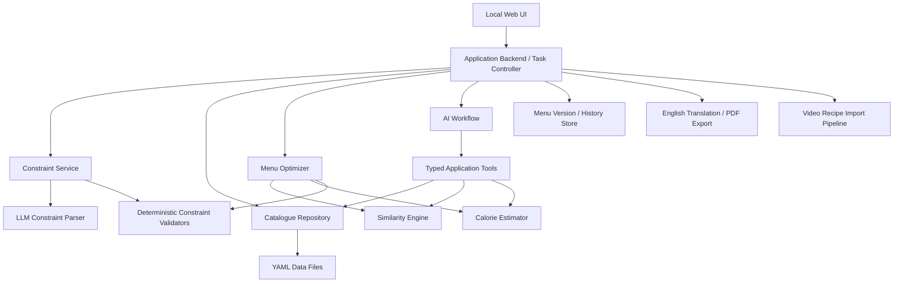

# Architecture and Technical Design

## 1. Design Goals

- Local-first, readable data storage.
- Deterministic validation for correctness-sensitive operations.
- LLM use limited to tasks that benefit from language understanding or generation.
- Shared constraint logic between full-menu generation and local menu adjustment.
- Clear separation of user-owned master data, AI candidates, approved dishes, menus, and task state.
- Expandable constraint types without rewriting the orchestration flow.
- Global menu optimization with independently verifiable hard constraints.
- Explainable optimization results, including infeasibility and trade-offs.

## 2. Proposed High-Level Architecture



This is a logical design, not a commitment to a particular web framework or agent runtime.

## 3. Runtime and Agent Orchestration

### 3.1 Runtime (decided — see ADR-003, ADR-004, ADR-005 in §12)

The core workflow runs in ordinary application code. Claude is called at explicit boundaries:

- **Structured calls (no tools):** constraint parsing, translation. The application sends text and a JSON schema and validates the returned object.
- **Agent calls (application-provided read-only tools):** candidate-dish generation, video recipe extraction. Claude chooses which tools to call; the application still validates every result before use.

Callers depend on a backend-neutral LLM interface, not on a specific invocation method, so the backend can be switched without rewriting callers.

This keeps execution, permissions, validation, and termination conditions under application control.

### 3.2 Agent and Tool Responsibilities

**LLM-assisted tasks**

- Parse natural-language constraints into a typed schema.
- Generate candidate recipes using available ingredients.
- Explain infeasibility and propose possible relaxations for user approval.
- Extract recipes from transcripts and available video context.
- Translate recipe content into English.

**Deterministic tools and services**

- Query ingredients and approved dishes.
- Validate ingredient IDs and dish schemas.
- Estimate calories from recipe quantities and servings.
- Aggregate dish categories and meal composition.
- Calculate dish similarity and whole-meal similarity.
- Check repetition windows.
- Solve the menu optimization problem.
- Save and version menu data.
- Export PDFs.

The LLM must not bypass application permissions or write canonical YAML directly.

## 4. Data Storage

YAML is the initial source of truth. A possible layout is:

```text
data/
  ingredients.yaml
  dishes.yaml
  pending_dishes.yaml
  constraints.yaml
  preferences.yaml
  menus/
    <menu_id>.yaml
    history/
      <menu_id>/
        <version_id>.yaml
```

The exact split can be adjusted as data grows. Keep schemas versioned so future migrations are possible.

### 4.1 Ingredient Records

Suggested fields:

- `ingredient_id`: stable ID.
- `name_zh`, `name_en`.
- Optional aliases.
- Optional category.
- Optional nutrition facts and unit basis, if available.
- Optional user-maintained notes.

AI may read this file but may not mutate it. The backend should expose read-only ingredient tools to AI workflows. User edits should pass through a separate explicit UI/API operation.

### 4.2 Dish Records

Suggested fields:

- `dish_id`.
- `name_zh`, `name_en`.
- `dish_type`: business role/category such as vegetarian, mixed meat-and-vegetable, major meat dish, or soup.
- `ingredients`: list of `{ingredient_id, quantity, unit}`.
- `servings` or yield basis.
- `steps`.
- Optional calorie estimate and estimation basis.
- `style`: main ingredients, cooking method, flavour, cuisine, core ingredient combination, and other supported features.
- `source`: manual, AI-generated, or video-imported.
- `review_status`: pending, approved, or rejected.
- Optional confidence/uncertainty and timestamps.

Do not conflate dish role with similarity features. Use stable IDs for references.

### 4.3 Constraint Records

Each constraint should preserve both natural-language intent and executable interpretation.

Illustrative YAML:

```yaml
constraint_id: C001
description: "Every dinner includes exactly one soup"
scope:
  - menu_generation
  - menu_adjustment
strictness: hard
source: persistent
execution:
  type: dish_type_count
  dish_type: soup
  min: 1
  max: 1
parse_status: executable
active: true
```

This is illustrative, not a finalized schema.

Useful metadata includes:
- Stable ID.
- Natural-language description.
- `scope`: `menu_generation`, `menu_adjustment`, or both.
- `source`: `persistent` or `task`.
- `strictness`: `hard` or `soft`.
- `execution`: structured execution type and typed parameters.
- `parse_status`: the parser outcome (see below).
- Conflict and override information.
- `active`: whether the constraint is currently enabled.

Two different status vocabularies apply to a constraint and must not be mixed:

- **`parse_status`** describes whether the constraint itself could be understood and represented: `executable`, `approximated`, `needs_clarification`, `unsupported`, or `conflict` (see `requirements.md` §3.2). It is stored with the constraint.
- **Validation result** describes whether a specific menu satisfies the constraint: `passed`, `failed`, `not_evaluable`, `approximated`, or `conflict` (see §7). It is produced per menu by the validator and stored in the menu's validation report, not in the constraint record.

The schema must support unsupported, approximate, ambiguous, and conflicting constraints. Never discard the original natural-language description after parsing.

### 4.4 Menu Records and History

A menu should record:
- Menu ID and version.
- Plan date range and the 20 target dinner dates.
- Diner composition.
- Selected dish IDs per dinner.
- Effective constraints or a stable snapshot/reference to them.
- Optimization and validation report.
- Unresolved or approximated constraints.
- Creation source and timestamps.
- Change history and rationale.

Prefer versioned writes rather than destructive in-place replacement. Use safe/atomic file writes and backups where practical.

## 5. Constraint Parsing and Resolution

### 5.1 Parsing Pipeline

1. Load persistent constraints.
2. Accept task-scoped additional natural-language constraints.
3. Parse new or changed text into typed constraint candidates.
4. Validate output against a schema and allowed constraint registry.
5. Determine whether each constraint is executable, approximate, ambiguous, unsupported, or conflicting.
6. Resolve explicit task-level overrides; ask the user about implicit conflicts.
7. Produce an effective constraint set for the requested task.
8. Pass validated structured rules to the optimizer and validators.

### 5.2 Constraint Registry

A registry should define, for each executable constraint type:
- Parameter schema.
- Applicable task scopes.
- Supported strictness modes.
- Validator or objective contribution.
- Required catalogue fields and tools.
- User-facing explanation format.

Do not interpret arbitrary LLM-generated code as a constraint implementation. Adding a new executable constraint type requires reviewed application code and tests.

### 5.3 Constraint Execution Model

The architecture distinguishes the following stages:

1. **Intent:** the user's original natural-language statement.
2. **Interpretation:** structured parameters proposed by the parser.
3. **Capability check:** whether available data and tools can evaluate the rule.
4. **Execution:** a validator or optimizer objective uses the structured rule.
5. **Reporting:** the system reports the result and any limitations.

An LLM's assertion that a constraint is satisfied is not a validation result.

## 6. Menu Optimizer Design

### 6.1 Recommended Approach

Treat menu planning as a global constrained optimization problem.

Evaluate Google OR-Tools CP-SAT as the first solver candidate. Keep the optimizer behind a small interface so a different solver or hybrid method can be substituted after prototyping.

Do not make 20 independent greedy choices: locally good choices can make later dates infeasible.

### 6.2 Inputs

The optimizer receives:

- The 20 target dinner dates.
- Diner composition and calorie target assumptions.
- Approved dish catalogue.
- Effective structured constraint set.
- Dish and ingredient features required for constraint checks and similarity.
- Relevant menu history and configured repetition window.
- Optional fixed menu items, especially for local adjustments.
- Solver configuration and optimization weights.

Pending or rejected dishes must not be selectable.

### 6.3 Decision Variables

For each target date and candidate dish, define a binary selection variable indicating whether that dish is selected for that meal.

The implementation may use explicit meal-role slots or model each meal as a set of selected dishes, depending on how flexible dish-type rules are.

A variable should only be created for a dish that is valid and eligible for the corresponding task. The model should not rely on an LLM to determine whether a completed solution meets the rules.

### 6.4 Hard Constraints

Depending on the effective constraint set, hard constraints may include:

- Required number of dishes and soup count per meal.
- Allowed dish-type counts and composition.
- Ingredient exclusions or required ingredients.
- Exact-repeat restrictions within a configured window.
- Approved-dish-only selection.
- Explicitly non-negotiable user instructions.
- Valid dates and fixed diner composition.

Hard constraints that cannot be expressed directly in the solver model must be checked separately. The plan must not be labelled fully feasible unless all applicable hard constraints pass the final validator.

### 6.5 Soft Objectives

Represent soft objectives as explicit penalties or rewards with configurable and documented weights.

Candidate objectives include:
- Deviation from the daily calorie target.
- Excessive similarity between dishes across dates.
- Excessive whole-meal similarity across dates.
- Repetition beyond the configured strict-repeat window, where permitted.
- Insufficient variety in cooking method, flavour, cuisine, or main ingredient.
- Mismatch with user preferences.

Avoid one opaque weighted score without a report. Return per-objective scores and explain the main trade-offs.

Where priorities are important, consider staged or lexicographic optimization, for example:
1. Find a solution satisfying all hard constraints.
2. Improve calorie consistency.
3. Improve variety and reduce excessive similarity.
4. Optimize lower-priority preferences.

The final ordering and weights remain open design decisions.

### 6.6 Calorie Estimation

Calorie estimation is deterministic given the nutrition facts, ingredient quantities, yields, and serving assumptions, but the underlying data may be approximate or missing.

Record:
- Estimated calories and unit basis.
- Number of servings or yield.
- Data coverage or confidence.
- Missing-nutrition warnings.

Do not imply medical-grade precision. If nutrition data is incomplete, expose uncertainty and use the result as an approximate planning signal.

### 6.7 Dish Similarity

Dish similarity is a deterministic score in the range 0–1 based on available features.

Candidate features include:
- Main ingredients.
- Cooking method.
- Flavour.
- Cuisine/style.
- Core ingredient combination.

Initial feature weights are tunable configuration and must be validated against representative examples. Missing features must be handled explicitly; missing data must not automatically be treated as evidence of dissimilarity.

Exact identity by `dish_id` should be checked separately from approximate similarity.

### 6.8 Whole-Meal Similarity

The initial whole-meal similarity baseline is the user's greedy matching procedure:

1. Build the cross-meal dish similarity matrix.
2. Select the highest-scoring remaining pair.
3. Add its score and remove the matched dishes.
4. Repeat until no pairs remain.
5. Sum matched scores.

Also compute a normalized score when comparing meals with different dish counts.

Preserve this baseline unless a future design decision explicitly changes it.

### 6.9 Hybrid Optimization Strategy

Whole-meal similarity is awkward to encode directly in a compact constraint model. The proposed first implementation is therefore a hybrid:

1. The solver produces a feasible, high-quality initial plan using tractable dish-level penalties.
2. A deterministic evaluator computes whole-meal similarity across the plan.
3. Local search or repair proposes swaps or replacements to reduce the worst similarity violations while preserving hard constraints.
4. An independent final validator checks the complete menu and reports soft-objective scores.

This strategy must be benchmarked with representative catalogue sizes before it is finalized. If a simpler solver model adequately meets quality and runtime requirements, prefer the simpler implementation.

### 6.10 Infeasibility and Catalogue Expansion

If the approved catalogue has no feasible solution:

1. Return a structured explanation of the constraints or candidate categories causing the shortage.
2. Identify the smallest useful catalogue gap where possible.
3. Ask the LLM to generate targeted candidate dishes using known ingredients.
4. Validate the candidate schema and ingredient references.
5. Place candidates in pending review.
6. After user approval, add approved candidates and rerun the optimizer.

Do not silently relax hard constraints or automatically approve generated dishes. If suggesting a relaxation, explain its impact and wait for the user's decision.

### 6.11 Menu Adjustment

Reuse the same constraint registry, validators, similarity engine, and optimizer.

1. Create a proposed new menu version with the target dish removed from its position.
2. Find replacement candidates compatible with the meal role and active constraints.
3. Solve the local replacement problem.
4. Validate the meal and compare its whole-meal similarity against other dates.
5. If no feasible local replacement exists, expand to the day or a larger date range.
6. Preserve unrelated approved dishes whenever possible.
7. Show the proposed diff and validation report before committing the new version.

## 7. Deterministic Validation

The final validator is independent of the LLM and returns machine-readable results per constraint, such as:

- `passed`
- `failed`
- `not_evaluable`
- `approximated`
- `conflict`

It checks the final complete menu, not just the intermediate solver result. Any change after validation invalidates the previous report and requires revalidation.

The overall plan status should distinguish:
- Feasible and validated.
- Feasible with unresolved or non-evaluable soft constraints.
- Infeasible under current hard constraints.
- Best-effort proposal that has not passed all required checks.

## 8. Video Import and PDF Export

### Video Import

Separate pipeline:

URL intake → accessible metadata/transcript retrieval → optional ASR/vision → structured recipe extraction → ingredient ID matching → schema validation → pending review.

Platform availability and permitted access must be checked. Do not assume every URL can be downloaded or transcribed.

### English PDF

Use approved recipe/menu data as input. Translation should preserve quantities, sequence, timing, and cooking details.

Validate that the PDF contains the expected recipes and is printable. Layout and page structure remain open decisions.

## 9. Observability and Error Handling

Log task IDs, module outcomes, validation summaries, solver status, and retry counts.

Avoid logging credentials or unnecessary sensitive information. For each failed task, provide a user-readable explanation and a technical diagnostic suitable for local troubleshooting.

## 10. Open Decisions

Decisions already made are recorded in §12.

- Final YAML schemas and migration strategy (to be settled in Phase 1).
- Exact LLM interface signatures and how the Claude Code CLI backend exposes application tools (to be settled in Phase 2).
- Solver choice after prototype benchmarking; OR-Tools CP-SAT is the current recommendation.
- Exact hard/soft classification for each default constraint.
- Similarity feature weights, thresholds, and comparison windows.
- How to encode whole-meal similarity penalties in local search.
- Nutrition data source and behavior when data is missing.
- Video transcript, ASR, and vision providers and platform constraints.
- English PDF layout and whether to include shopping lists.


## 11. Web UI Architecture Reference

**Reference repository:** https://github.com/VinceCarrot/Family-Accounting-Web-UI

The repository is used exclusively as a reference for Web UI file and directory organization, module boundaries, and separation of responsibilities.

Its business logic, implementation code, domain models, UI styling, and product requirements are not authoritative for this project.

The final Web UI architecture must be adapted to this project's requirements and confirmed technology stack.

The adapted Web UI structure is recorded in ADR-006 (§12).

## 12. Architecture Decision Records

Each record states its status. "Confirmed" means the user explicitly approved it; "Default" means a low-impact implementation choice that may be revisited without a design discussion.

### ADR-001 Python environment — Confirmed (2026-10-12)

- Conda environment `meal-planner`, Python 3.11.
- Packaging through `pyproject.toml`; install with `pip install -e .[dev]`.

### ADR-002 Schema validation library — Confirmed (2026-10-12)

- pydantic v2 for YAML records and for all LLM output.
- Reason: typed validation with field-level error messages, used both for user data files and for untrusted model output.

### ADR-003 Model provider and access path — Confirmed (2026-10-12)

- Claude only. Local models are not used.
- First access path: the Claude Code CLI in non-interactive mode (`claude -p`), invoked as a subprocess and authenticated with the user's own Claude subscription. This is the officially documented way to run Claude Code from another program.
- The standalone CLI must be installed and on `PATH`. The copies bundled inside the Claude desktop app or the VS Code extension are not used, because their paths change on update.
- `ANTHROPIC_API_KEY` must be unset, otherwise the CLI uses the key instead of the subscription.
- Rejected: automating the claude.ai web interface (for example with Playwright). Anthropic's consumer terms prohibit automated access to the consumer service without an API key, and the usage policy prohibits routing requests through consumer subscriptions.
- Subscription login is for this user's personal use. The application must not be distributed with subscription-based login.

### ADR-004 Orchestration model — Confirmed (2026-10-12)

Hybrid:

- Application code controls the main workflows: generation, adjustment, validation, saving.
- Structured calls without tools: constraint parsing, translation.
- Agent calls with application-provided read-only tools: candidate-dish generation, video recipe extraction.
- A fully agent-orchestrated workflow was considered and not chosen, because it is harder to test and reproduce and uses more calls.

### ADR-005 Backend-neutral LLM interface — Confirmed (2026-10-12)

The user may later switch the invocation method (for example to the Anthropic API or the Agent SDK). Switching must not require rewriting callers.

- Callers depend on a small interface with two operations:
  - `structured(system, prompt, output_schema)` returns one JSON object;
  - `agent(system, prompt, tools, output_schema)` runs a tool-using loop and returns one JSON object.
- Tools are defined once in a backend-neutral form: name, description, JSON input schema, and a Python handler.
- Each backend adapts these definitions to its own mechanism. The first backend is `claude -p`; other backends implement the same interface.
- The backend is selected by configuration.
- Tests use a fake backend and never call a real model.
- Permission enforcement does not depend on the backend. The tool set given to AI contains only read operations; every write goes through application services after validation.
- Exact signatures, and how the CLI backend exposes application tools (expected: an MCP server passed with `--mcp-config`, with built-in tools disabled), are finalized and verified in Phase 2.

### ADR-006 Web UI structure — Confirmed (2026-10-12)

Follows the structural approach of the reference repository (§11), adapted to this project:

- Flask serves one Jinja shell page assembled from per-feature partials (`templates/modules/<feature>.html`).
- The front end uses vanilla ES modules, with one folder per feature (`static/modules/<feature>/<feature>.js|.css`). It loads data from JSON endpoints with `fetch`. There is no Node build step.
- Unlike the reference repository, endpoints are business operations (for example "approve pending dishes"). There is no generic "write this data to this file path" endpoint, because that would bypass the ingredient permission boundary.
- Flask is added as a dependency in Phase 6.

### ADR-007 Dish types — Confirmed (2026-10-12)

- `dish_type` is a fixed enum: `vegetarian`, `mixed` (meat and vegetable), `meat` (major meat dish), `soup`.
- Meal composition is expressed as count ranges per dish type.
- Adding a type requires a code change.

### ADR-008 Calorie fields — Confirmed (2026-10-12)

- Ingredient records have an optional `kcal_per_100g`. An optional per-unit gram weight is used to convert non-mass units.
- Dish records have an optional `calories_kcal` with its basis (servings, and whether it was computed or estimated).
- Calorie-related constraints are deferred. They are not part of the initial constraint registry, and the optimizer does not use calories until this decision is revisited.

### Defaults

- Stable IDs use readable prefixes: `ing_<slug>` for ingredients, `dish_<nnnn>` for dishes, `C<nnn>` for constraints. Final formats are fixed in the Phase 1 schemas.
- Application-owned YAML files are written atomically (temporary file plus `os.replace`). The previous version is kept as a `.bak` file.
